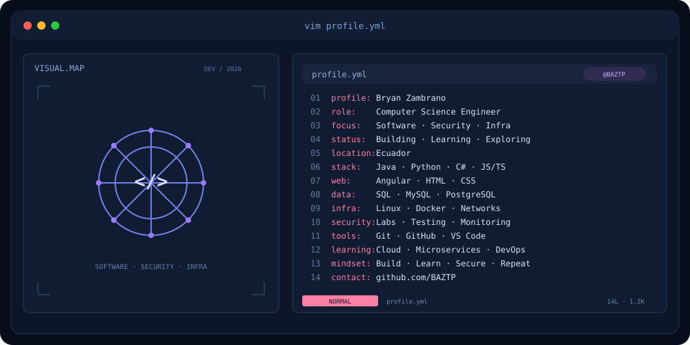

  

<h1 align="center">👋 Hi, I'm Bryan</h1>

<h3 align="center">
  💻 Computer Science Engineer
</h3>

  Software Development • Cybersecurity • Networks • Cloud • Infrastructure

  

---

# 👨‍💻 About Me

I'm a **Computer Science Engineer** based in Ecuador, passionate about building software, exploring cybersecurity, configuring networks, and solving real-world technology challenges.

My technical interests span **Full Stack Development, IT Infrastructure, Cisco Networking, Database Management, Cloud Computing, Cybersecurity, and QA Testing**.

I enjoy combining software engineering with practical laboratories, troubleshooting, system administration, and continuous learning.

### 🚀 What I'm Focused On

- 💻 Building web and software applications
- ☕ Developing with Java, Python, C#, JavaScript, and PHP
- 🌐 Exploring Angular, TypeScript, and REST APIs
- 🗄️ Working with SQL and NoSQL databases
- 🛡️ Practicing cybersecurity in controlled laboratories
- 📡 Exploring Cisco networking labs and troubleshooting
- ☁️ Learning AWS, Docker, and DevOps practices
- 🧪 Improving software testing and QA knowledge
- 📷 Exploring CCTV, DVR, and network infrastructure
- 🤖 Creating automation scripts and interactive projects

---

# 🛠️ Technologies & Tools

### 💻 Programming Languages

  

  
  
  

### 🌐 Web & Backend Development

  

  
  
  
  

### 🗄️ Databases

  

  
  
  

### ⚙️ Development Tools & Platforms

  

  
  
  

### ☁️ Cloud & DevOps

  
  
  
  
  

### 🌐 Cisco Networking & Infrastructure

  
  
  
  
  
  
  

### 🛡️ Cybersecurity & Malware Analysis

  
  
  
  
  
  
  

### 📱 Mobile Development & QA

  
  
  
  
  

### 📷 Security Systems & Monitoring

  
  
  
  
  

---

# 🏗️ Software Architecture

  
  
  
  
  

I'm interested in designing maintainable, scalable, and modular applications using modern software engineering principles.

### 🔧 Architecture Concepts

- SOLID Principles
- MVC Architecture
- REST APIs
- Microservices
- Domain-Driven Design
- Modular Applications
- Testing and Code Quality
- Backend and Database Integration

---

# 🛡️ Cybersecurity

I'm exploring cybersecurity through controlled laboratories, web application security testing, and defensive analysis.

### 🔐 Areas of Interest

- Vulnerability Analysis
- Web Application Security
- Authentication Security
- Ethical Hacking Laboratories
- Network Security
- Malware Analysis
- Mobile Application Security
- Security Monitoring
- Incident Analysis

### 🔬 Security Laboratory Activities

- Practicing web security testing with Burp Suite
- Exploring authentication and access-control weaknesses
- Reviewing suspicious files with VirusTotal
- Studying sandbox analysis with ANY.RUN
- Exploring Hybrid Analysis and CAPE Sandbox
- Understanding Indicators of Compromise (IoCs)
- Learning MITRE ATT&CK techniques
- Reviewing processes and security reports

> All offensive security experimentation is intended for authorized and controlled environments.

---

# 🌐 Infrastructure & Networking

I have studied Cisco networking topics and explored practical infrastructure configuration and troubleshooting.

### 📡 Networking Knowledge

- Network Address Translation (NAT)
- Dynamic Host Configuration Protocol (DHCP)
- Static Routing
- Dynamic Routing
- TCP/IP Fundamentals
- Router and Network Configuration
- Connectivity Troubleshooting
- Network Security Fundamentals
- Infrastructure Monitoring

### 🖥️ IT Infrastructure

- Windows and Linux Environments
- Virtual Machines
- Technical Support
- Network Diagnostics
- CCTV and DVR Systems
- Security Camera Troubleshooting
- System Administration Fundamentals

### 📚 IT Management Frameworks

- ITIL Concepts
- COBIT Concepts
- IT Service Management Fundamentals

---

# 🚀 Featured Projects

<table>
<tr>
<td width="50%" valign="top">

<h3>🛡️ Cybersecurity Laboratory</h3>

Web platform concept for learning and practicing cybersecurity through controlled and simulated laboratories.

<b>Planned Features</b>

<ul>
<li>User management</li>
<li>Security laboratories</li>
<li>Vulnerability analysis</li>
<li>Interactive dashboard</li>
<li>Levels and achievements</li>
<li>Automatic reports</li>
<li>Progress tracking</li>
</ul>

<b>Proposed Stack</b>

<code>Angular</code>
<code>Java</code>
<code>SQL</code>
<code>Docker</code>

</td>
<td width="50%" valign="top">

<h3>📷 Security Camera & Network Quotation System</h3>

Technology quotation platform concept focused on security cameras, networking equipment, and electronic products.

<b>Planned Features</b>

<ul>
<li>Product catalog</li>
<li>Security cameras</li>
<li>Networking equipment</li>
<li>Customer management</li>
<li>Professional quotations</li>
<li>Quotation generation</li>
<li>Dashboard</li>
</ul>

<b>Proposed Stack</b>

<code>Angular</code>
<code>TypeScript</code>
<code>Java</code>
<code>SQL</code>

</td>
</tr>

<tr>
<td width="50%" valign="top">

<h3>🌆 Smart City 3D</h3>

Interactive 3D smart-city project concept focused on visualization, monitoring, and technological infrastructure.

<b>Concepts</b>

<ul>
<li>Traffic monitoring</li>
<li>Smart lighting</li>
<li>IoT devices</li>
<li>Smart buildings</li>
<li>Network infrastructure</li>
<li>Real-time monitoring</li>
</ul>

<b>Explored Stack</b>

<code>JavaScript</code>
<code>3D</code>
<code>Web</code>

</td>
<td width="50%" valign="top">

<h3>🛒 Technology Store</h3>

E-commerce platform concept focused on security cameras, networking equipment, and electronic products.

<b>Planned Features</b>

<ul>
<li>Security cameras</li>
<li>Networking equipment</li>
<li>Electronic components</li>
<li>Accessories</li>
<li>Connectivity equipment</li>
<li>Online catalog</li>
</ul>

<b>Proposed Stack</b>

<code>Angular</code>
<code>TypeScript</code>
<code>SQL</code>

</td>
</tr>
</table>

---

# 🧪 Additional Technical Labs & Projects

| Project / Laboratory | Technologies | Focus |
|---|---|---|
| ☁️ AWS S3 Static Website | AWS S3, HTML | Static website hosting and deployment practice |
| 🗄️ MongoDB Query Laboratory | MongoDB | Filtering, sorting, projections, aggregation pipelines |
| 🐘 PHP & MySQL Automation | PHP, MySQL | Database-driven status updates and conditional logic |
| 📱 Android Application Practice | Java, XML, Android Studio | Basic Android UI and event handling |
| 🧠 Logic Programming | Prolog | Rules, recursion, factorial, Fibonacci, logical inference |
| 🌐 Cisco Networking Labs | Cisco, NAT, DHCP, Routing | Network configuration and connectivity concepts |
| 🛡️ Web Security Laboratory | Burp Suite | Authorized authentication and security testing |
| 🔬 Malware Analysis Practice | VirusTotal, ANY.RUN, CAPE | Sandbox reports, processes, IoCs, MITRE ATT&CK |
| 📷 CCTV Troubleshooting | Hikvision, DVR | Camera diagnostics and video monitoring |
| 🏠 Interactive Network House | Java, 3D Concepts | Interactive visualization of Cisco networking equipment |
| 🤖 Automation Experiments | Python, PowerShell | Scripts and workflow automation |

> These activities include hands-on exercises, experiments, learning projects, and concepts under development.

---

# ☁️ Cloud Computing & DevOps

I'm expanding my knowledge of cloud services, automation, and software delivery workflows.

### ☁️ Cloud Practice

- Amazon Web Services Fundamentals
- Amazon S3
- Static Website Hosting
- Cloud Storage Concepts
- Web Deployment Fundamentals

### ⚙️ DevOps Learning

- Git and GitHub
- Docker Fundamentals
- CI/CD Concepts
- GitHub Actions Exploration
- Deployment Workflows
- Automation Scripts

---

# 🧪 QA & Software Testing

I'm interested in software quality assurance and improving application reliability through systematic testing.

### 🔍 Testing Concepts

- Functional Testing
- Manual Testing
- Test Case Design
- Bug Reporting
- API Testing Fundamentals
- Regression Testing Concepts
- Software Debugging
- CI/CD and Quality Gates

---

# 📊 GitHub Statistics

  

---

# 🔥 GitHub Streak

  

---

# 🐍 Contribution Snake

  <picture>
    <source
      media="(prefers-color-scheme: dark)"
      srcset="https://raw.githubusercontent.com/BAZTP/BAZTP/output/github-snake-dark.svg">
    <source
      media="(prefers-color-scheme: light)"
      srcset="https://raw.githubusercontent.com/BAZTP/BAZTP/output/github-snake.svg">
    
  </picture>

---

# 📚 Development Journey

| Area | Technologies & Focus |
|---|---|
| 💻 Software Development | Java, Python, C#, C, PHP |
| 🌐 Web Development | Angular, HTML, CSS, JavaScript, TypeScript |
| 🖥️ Backend | Java, PHP, REST APIs, SQL Integration |
| 🗄️ Databases | MySQL, PostgreSQL, SQL Server, MongoDB |
| 🛡️ Cybersecurity | Burp Suite, VirusTotal, Security Labs |
| 🔬 Malware Analysis | ANY.RUN, Hybrid Analysis, CAPE, MITRE ATT&CK |
| 🌐 Cisco Networking | NAT, DHCP, Static and Dynamic Routing |
| 🖥️ IT Infrastructure | Windows, Linux, Virtual Machines |
| 📷 CCTV | Hikvision, DVR, Camera Troubleshooting |
| ☁️ Cloud | AWS, Amazon S3, Static Hosting |
| 🐳 DevOps | Git, GitHub, Docker, CI/CD Concepts |
| 📱 Mobile | Android, Java, XML |
| 🧪 QA | Manual Testing, Functional Testing |
| 🧠 Logic Programming | Prolog |
| 🤖 Automation | Python, PHP, PowerShell |
| 🏗️ Architecture | MVC, SOLID, Microservices, DDD |
| 🤖 Artificial Intelligence | Exploring |

---

# 🧰 Development Environment

| Category | Tools |
|---|---|
| 💻 IDE | VS Code, Visual Studio, Android Studio |
| 🔧 Version Control | Git, GitHub |
| 🐳 Containers | Docker |
| 🐧 Operating Systems | Windows, Linux, Kali Linux |
| 🗄️ Relational Databases | SQL Server, MySQL, PostgreSQL |
| 🍃 NoSQL | MongoDB |
| 🌐 Frontend | Angular, HTML, CSS, JavaScript, TypeScript |
| ☕ Backend | Java, Python, C#, PHP |
| 📱 Mobile | Android Studio, Java, XML |
| 🛡️ Security | Burp Suite, VirusTotal, ANY.RUN |
| 📡 Networking | Cisco, NAT, DHCP, Routing |
| ☁️ Cloud | AWS, Amazon S3 |
| 🧪 Testing | QA Fundamentals, Functional Testing |
| 📊 Monitoring | System and Network Monitoring |

---

# 🌱 Currently Learning

  
  
  
  
  
  
  

---

# 🎯 2026 Goals

<table align="center">
<tr>
<td align="center">
🚀
<h4>Software Development</h4>
Build production-ready projects
</td>
<td align="center">
🛡️
<h4>Cybersecurity</h4>
Improve security knowledge
</td>
<td align="center">
☁️
<h4>Cloud Computing</h4>
Expand AWS knowledge
</td>
</tr>
<tr>
<td align="center">
🌐
<h4>Networking</h4>
Strengthen Cisco skills
</td>
<td align="center">
🧪
<h4>Software Quality</h4>
Improve QA practices
</td>
<td align="center">
🤝
<h4>Open Source</h4>
Contribute to projects
</td>
</tr>
</table>

---

# 💡 What I Like Building

  <code>🌐 Web Applications</code>
  <code>📱 Mobile Applications</code>
  <code>🖥️ Desktop Applications</code>
  <code>🛡️ Cybersecurity Labs</code>
  <code>📊 Monitoring Systems</code>
  <code>🌐 Network Tools</code>
  <code>📷 Security Camera Systems</code>
  <code>🛒 E-Commerce</code>
  <code>🤖 Automation</code>
  <code>🌆 Smart City</code>
  <code>☁️ Cloud Projects</code>
  <code>🧪 QA Testing</code>

---

# 🧠 Learning Philosophy

  <h3>🚀 Build. Learn. Secure. Repeat.</h3>
  <i>Build it. Break it. Understand it. Improve it.</i>

I believe the best way to learn technology is by building real projects, experimenting with different solutions, understanding failures, and continuously improving.

---

# 💼 Professional Interests

I'm interested in professional opportunities involving software development, IT infrastructure, and technology.

### 🎯 Roles of Interest

- 💻 Junior Software Developer
- 🌐 Full Stack / Backend Developer
- 🖥️ IT Support Specialist
- 📡 Network Support / Network Engineer
- 🧪 Junior QA Tester
- 🛡️ Junior Cybersecurity Analyst
- ☁️ Junior Cloud / DevOps Roles
- 📊 Junior Data Analyst

  
  
  

---

# 🤝 Open Source & Collaboration

I'm interested in collaborating on projects related to:

- Software Development
- Cybersecurity
- Cisco Networking and Infrastructure
- Monitoring and Automation
- Cloud Technologies
- QA and Software Testing
- Artificial Intelligence
- Open Source Projects

  <b>Always open to learning, building, and collaborating.</b>

---

# 📫 Connect With Me

  

  

  <i>💻 Software • 🛡️ Security • 🌐 Infrastructure • ☁️ Cloud • 🚀 Innovation</i>

---

  

